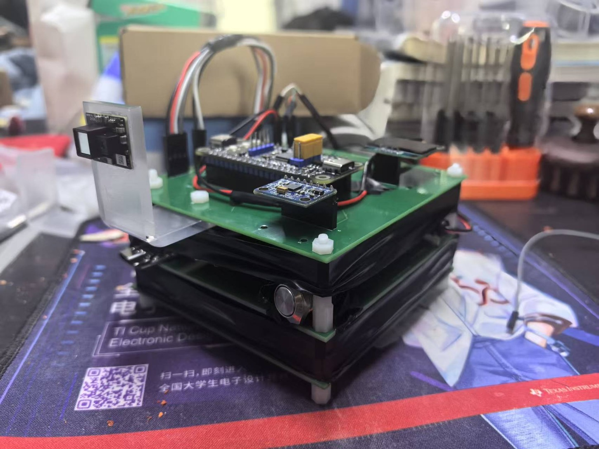

# TreeMeter A13 · 便携式树高测量仪

用 STM32F103C8T6 读取激光测距和姿态数据，在 OLED 上显示测量过程。课程设计从面包板联调走到 A13 自制载板，实物用尼龙柱、备用 PCB 和绝缘胶带搭成双层结构。

| 目录 | 内容与入口 |
| --- | --- |
| firmware | R4 固件。用 Keil µVision 打开 `GTI-test.uvprojx`，按[固件说明](firmware/README.md)构建和操作。 |
| hardware | A13 原理图预览、元件清单、PCB 工程、封装库和设计检查记录。 |
| simulation | 用 KiCad 打开 `A13_Laser.kicad_pro`，查看激光供电支路的瞬态仿真。参数、运行方式和适用范围见[使用说明](simulation/使用说明.txt)。 |
| model | Blender 实物装配模型。底板依据 100 × 100 mm 的 A13 工程，支架、线束及遮挡部分按实拍估算。 |

## 采购与备料

[查看 A13 采购清单](docs/procurement.md)，按单台列出打板、排针排母、电源板、电池、传感器与装配耗材的规格、数量和用途。

## 从接线到测量

先在面包板验证测距、测角和显示，再将模块装到 A13 上。测量时固定激光模块与姿态模块的相对位置，按 OLED 提示测距并依次记录树顶、树底方向。固件编译、供电仿真和整机外场精度分别记录；20 m 量程和 ±0.5 m 精度是设计目标，尚待整机实测验证。

[实践日志、答辩材料和 45 秒实物短片](https://electronics-course-hub.qifan89.chatgpt.site/treemeter-log.html)

## 项目分工

王伊凡担任组长，负责总体设计、固件、仿真、系统联调与项目整理。赖颖辰负责焊接设计、实操排障和 PCB 故障处理与维护。王之谦负责建模、拼装和搭建方案。

## 许可证

小组原创部分采用 [MIT 许可证](LICENSE)。固件中的 Arm、STMicroelectronics 和 Keil 设备支持文件沿用各自的版权与许可条款，详见文件头及 [第三方许可文本](licenses/)。
